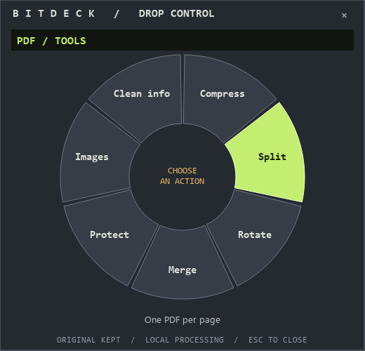

# BitDeck

**Drag a file. Press Shift. Drop on an action.**

A Windows file utility inspired by DragShift's cursor workflow and Winamp's
compact, tactile controls. Images, PDFs and plain text; no Office installation,
no Word automation, no liquid glass. The image editor is an optional tool.



## The workflow

1. Start BitDeck. It lives in the system tray.
2. Start dragging a supported file in Explorer or on the desktop.
3. Press **Shift** while holding the mouse button. Move into the wheel that
   appears near your cursor, then drop onto an action.
4. Tap **Shift** again while dragging for **Tools**.
5. The result card reports output sizes and offers **Open folder** and **Undo**.

Drop in the center to choose afterward. Escape closes the menu. In click mode,
Tab switches Convert/Tools, arrows select, and Enter applies. Double-click the
tray icon to choose files without dragging. One drop must contain one file family.

## Implemented in v0.2

| Input | Convert | Tools |
| --- | --- | --- |
| PNG, JPEG, WebP | PNG, JPEG, WebP; one or several images to one PDF | Compress, resize, opaque redaction in the optional editor, remove image metadata |
| PDF | PNG/JPEG per page; existing text layer to UTF-8 TXT | Lossless compression, split, rotate, merge in drop order, AES-256 protection, extract embedded images, clear document Info/XMP |
| Text | Paginated PDF; normalize to UTF-8 TXT | The same two plain-text operations |

Text suffixes include `.txt`, `.md`, `.csv`, `.tsv`, `.json`, `.log`, `.xml`,
`.html`, `.yaml`, `.yml`, `.ini`, `.cfg`, `.toml`, `.css`, `.js`, `.ts`, `.py`
and `.sql`. Supported encodings: UTF-8, BOM-marked UTF-16 and Windows-1252.
Markup/code is printed literally; nothing is executed or fetched.

PDF/text outputs are ordinary interoperable files. This does not mean arbitrary
inputs, perfect layout reconstruction, every script/encoding, or OCR. Scanned PDFs
may yield no text. Text PDFs embed Windows Consolas when available; font coverage
and complex-script shaping are limited. Lossless PDF compression may not reduce
size. Clearing document metadata is not full PDF sanitization.

**Word files are deliberately excluded.** HEIC/AVIF/TIFF inputs, crop/annotation
editors, OCR, skins, autostart registration and signed installers are not included.
This prototype does not claim full DragShift feature parity.

## Run on Windows

Requires **64-bit Python 3.10+**. The lock files contain Windows x64 wheels.

```powershell
python -m venv .venv
.\.venv\Scripts\python.exe -m pip install --require-hashes -r requirements-lock.txt
.\.venv\Scripts\python.exe -m bitdeck
```

Or run `setup.cmd`, then `launch.cmd`. `--quiet` starts without a welcome card;
`--workbench` opens the optional image editor. Passing file paths opens their
cursor menu and hands off to an existing instance when available.

The tray's **Explorer / Send to integration** command offers explicit per-user
registration/removal. On Windows 11, look under **Show more options**. Registration
is not installed automatically and needs no administrator privileges. Keep the
source installation at its registered path; remove integration before moving it.

Outputs default to a `BitDeck` folder beside the original. Collisions get numbered
names. Originals are kept. The image editor has its own output-folder override.
Undo uses only the Recycle Bin; unavailable recycling or changed file identity
leaves the output in place.

## Verification status

Automated processing and Qt integration tests run real worker processes and verify
outputs. Cursor checks submit native Qt drag/drop events and verify copy-only
acceptance, action routing, output generation and the Shift polling state machine.
**They are not a live Explorer/OLE drag test.**

The development sandbox denies the user-only named pipe, so live single-instance
handoff and Explorer/Send to registration remain unverified here. Startup reports
an error if it cannot establish the instance channel. Those checks require a
normal interactive Windows session. See [validation](docs/validation.md).

## Safeguards and limits

Conversions use short-lived workers with Windows Job Object memory/CPU limits,
a 90-second deadline, bounded JSON messages, and fail-closed limit attachment.
The worker allowance is 768 MiB committed memory per process, 60 seconds CPU and
two processes including Python's venv launcher. These are resource limits,
**not a filesystem/network security sandbox**.

Inputs/outputs are capped at 64 MiB; document outputs share a 64 MiB job budget.
Images: 40 MP / 16,384 px per side, single-frame only. PDFs: 200 pages; raster
export: 50 pages. Text: 2 MiB / 500,000 characters. Combined inputs: 50 files.

Exclusive temporary files and atomic no-replace publication avoid overwrites.
Ordinary document failures roll back their outputs; forced cancellation may leave
partial/completed outputs or temporary files. Image exports rebuild metadata-free
pixels; redaction uses opaque black boxes. Only editor exports bind their source
to the inspected SHA-256. The app has no intentional network requests or telemetry.
See [SECURITY.md](SECURITY.md).

## Development

```powershell
.\.venv\Scripts\python.exe -m pip install --require-hashes -r requirements-dev-lock.txt
New-Item -ItemType Directory -Force work | Out-Null
.\.venv\Scripts\python.exe -m pytest -q --basetemp=work/test-data
```

Windows CI is configured with pinned actions; it has not run on GitHub because
publication is paused. See [architecture](docs/architecture.md).

## Attribution and license

Original code/artwork are MIT. Winamp inspires the visual character; DragShift
inspires the cursor interaction. Neither project is affiliated with BitDeck, and
no DragShift source was copied. Dependencies retain their own licenses. Future
binary releases must include applicable notices and satisfy their terms.

## Next steps

- Live Explorer/OLE and shell integration validation
- Input PDF password prompt, richer image formats and editing tools
- Restricted worker filesystem/network access
- Signed installer, binary provenance, presets and skins
