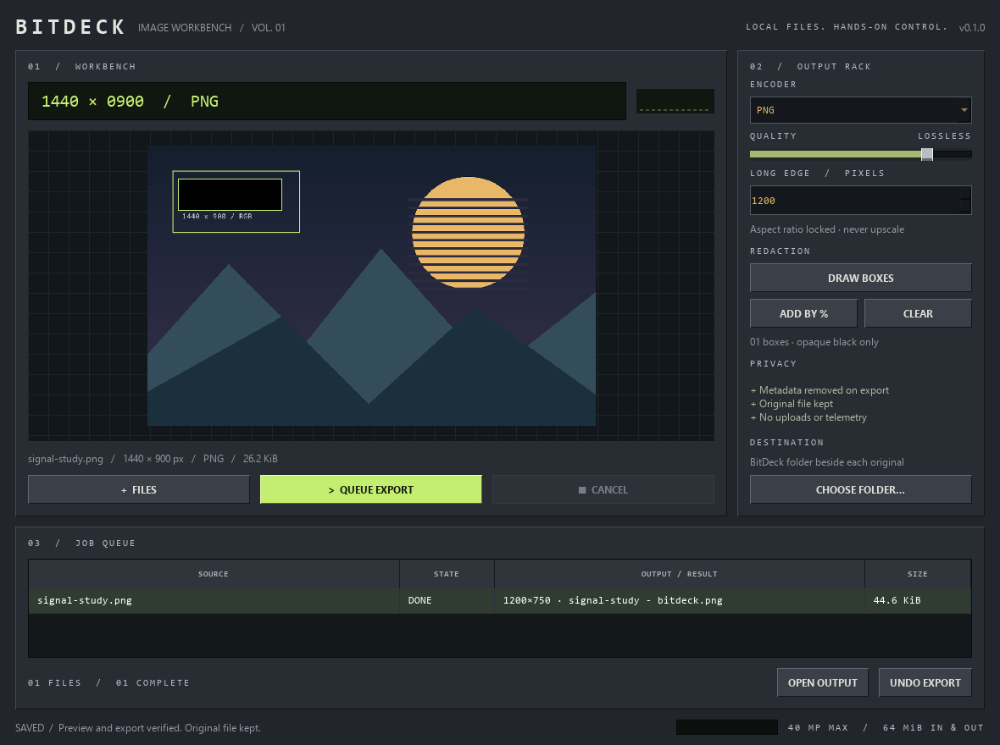

# BitDeck

**A compact Windows image workbench with a retro soul.**

Tactile controls. An inset display. A queue you can actually read. Inspired by
classic desktop audio software, built for working with images.



## What works in v0.1

- Drop PNG, JPEG and WebP files onto the workbench, or press **Ctrl+O**.
- Convert formats, set compression quality, and resize without upscaling.
- Draw solid black redaction boxes, or enter box coordinates using **Add by %**.
- Strip metadata on every export; preserve the original file.
- Inspect files and export through separate, short-lived worker processes.
- Queue exports with captured settings; cancel active and waiting exports.
- Open output folders and undo an export through the Recycle Bin.

This is an early source prototype. PDF/Word tools, installers, skins and signed
binary releases are not implemented.

## Run on Windows

Requires **64-bit Python 3.10+**. Tested locally on Windows with Python 3.10
on a local NTFS workspace. The lock file contains Windows
x64 wheels; other platforms and architectures are not part of this release.

```powershell
python -m venv .venv
.\.venv\Scripts\python.exe -m pip install --require-hashes -r requirements-lock.txt
.\.venv\Scripts\python.exe -m bitdeck
```

Or run `setup.cmd`, followed by `launch.cmd`. Add files, select a row, tune the
output rack, and click **Queue export** (**Ctrl+Enter**). Add several files and
queue each with its own settings while another export is processing.

Outputs go in a `BitDeck` folder beside each source unless you choose a different
destination. Repeated exports receive numbered names. Input bytes determine the
decoder; renaming an unsupported document to `.jpg` does not make it supported.

## Safety properties and limits

- Exclusive temporary files and atomic **no-replace** publication prevent output
  name collisions from silently overwriting files. Windows uses a same-directory
  rename that refuses existing destinations; there is no overwriting fallback.
- Original input bytes are never modified by the conversion code.
- PNG/JPEG/WebP exports are rebuilt from pixels without original metadata.
- Redaction replaces selected pixels with opaque black before resize/encoding.
  Lossy encoders may change boundary colors; use PNG when exact pixels matter.
- Undo never falls back to permanent deletion. It refuses if a recorded output's
  file identity/size/modification time has changed.
- Inputs and encoded outputs are capped at **64 MiB**; images at **40 MP** and
  **16,384 px** per side. Animated files are rejected.
- Workers have a **90-second wall-clock deadline**. On Windows, a Job Object
  limits each worker to **768 MiB committed memory**, **60 seconds of CPU time**,
  two processes (including Python's virtual-environment launcher), and termination
  when its job handle closes. Failure to attach
  limits prevents processing. Inspection and export can run concurrently, each
  with its own limits.

**Process separation and resource limits are not a security sandbox.** Workers
run with your account's file/network permissions. Qt decodes the worker-generated
preview in the UI. See [SECURITY.md](SECURITY.md) for the threat model and remaining
risks. No claim of safety against arbitrary malicious files is made.

Cancelling or a forced exit can leave an incomplete `.bitdeck-*.part` file in the
destination, or a completed output if publication already happened. These files
are not automatically removed after forced termination, to avoid deleting a file
owned by another job. Review the destination before retrying. No output is opened
automatically. The app makes no intentional network requests and has no telemetry.

## Development

```powershell
.\.venv\Scripts\python.exe -m pip install --require-hashes -r requirements-dev-lock.txt
New-Item -ItemType Directory -Force work | Out-Null
.\.venv\Scripts\python.exe -m pytest -q
```

Tests cover concurrent output collisions, publication races, temporary-file
cleanup on ordinary failure, input/output budgets, redaction, orientation,
metadata removal, worker lifecycle, cancellation, timeouts and Windows Job Object
termination. CI runs on Windows. See [architecture](docs/architecture.md).

## Design and attribution

Winamp's classic desktop character inspired the compact rack, beveled controls,
and inset status display. All layouts and visual assets here are original; this
project is not affiliated with Winamp. DragShift inspired the file-tool concept
and the decision to investigate output safety. No DragShift source was copied.

BitDeck uses Qt for Python (PySide6 Essentials, available under LGPLv3/GPLv3 or
commercial terms) and Pillow (HPND). This repository's original code is MIT.
Any future binary distribution must include applicable third-party notices and
fulfill its dependencies' license obligations. Dependencies are not vendored here.

## Roadmap

- [x] Image workbench and per-file queue
- [x] Worker resource limits and collision-safe output
- [x] Solid redaction and metadata-free export
- [ ] Restricted Windows worker token / filesystem and network isolation
- [ ] A signed installer and reproducible binary release pipeline
- [ ] PDF tools in separately reviewed workers
- [ ] Skins, saved presets and richer batch controls
