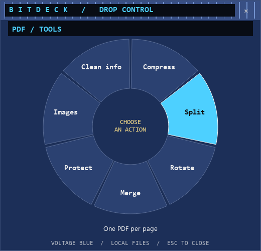

# BitDeck

**Drag a file. Press Shift. Drop on an action.**

A Windows file utility inspired by DragShift's cursor workflow and Winamp's
compact, tactile controls. Images, PDFs and plain text; no Office installation,
no Word automation, no liquid glass. The image editor is an optional tool.


## Privacy built in

**Your files. Your machine. Your control.**

BitDeck processes files locally and works offline. No account, API key or cloud
service is required. The app does not upload your documents or send usage analytics.

- **Clean image exports by default.** Images are rebuilt from pixels with metadata
  removed. Keeping common camera EXIF is an explicit choice, with a separate
  option to exclude standard GPS tags.
- **Redaction replaces pixels.** Opaque boxes are rendered into the exported
  image. Original embedded thumbnails and opaque maker notes are dropped, including
  when common EXIF retention is enabled.
- **Passwords stay out of saved history.** PDF passwords are used in memory for
  active controls and pending jobs. They are never written to settings or retained
  in completed job history; password jobs require re-entry to retry.
- **Originals stay yours.** Edits create separate copies. Existing output files
  are never overwritten, and Undo uses the Recycle Bin without a permanent-delete
  fallback.
- **Document privacy is in your hands.** Inspect and edit PDF metadata, remove
  document Info/XMP, and protect exported PDFs with AES-256 password encryption.
- **The protections are inspectable.** Source code, processing limits and
  regression tests are included, with the security model documented openly.

Review visible content before sharing: names, faces and place names can still
identify someone after metadata removal. PDF metadata cleanup covers Info/XMP;
embedded content and attachments need separate review. See [SECURITY.md](SECURITY.md)
for the full protections and limits.

## The workflow

1. Start BitDeck. It lives in the system tray.
2. Start dragging a supported file in Explorer or on the desktop.
3. Press **Shift** while holding the mouse button. Move into the wheel that
   appears near your cursor, then drop onto an action.
4. Tap **Shift** again while dragging for **Tools**.
5. The result card reports output sizes and offers **Open folder** and **Undo**.

Drop in the center to choose afterward. Escape closes the menu. In click mode,
Tab switches Convert/Tools, arrows select, and Enter applies. Double-click the
tray icon to choose files without dragging. One drop must contain one file family.

## Implemented in v0.4

| Input | Convert | Tools |
| --- | --- | --- |
| PNG, JPEG, WebP | PNG, JPEG, WebP; one or several images to one PDF | Compress, resize, crop, rotate, flip, opaque redaction, arrows/boxes/marker/text/steps, inspect and control metadata |
| PDF | Selected pages to PNG/JPEG; existing text layer to UTF-8 TXT | Page preview, ranges, drag reordering, merge, omit/rotate pages, split, lossless compression, AES-256 protection, password input/decrypted copies, embedded images, inspect/edit/clear metadata |
| Text | Paginated PDF; normalize to UTF-8 TXT | The same two plain-text operations |

Text suffixes include `.txt`, `.md`, `.csv`, `.tsv`, `.json`, `.log`, `.xml`,
`.html`, `.yaml`, `.yml`, `.ini`, `.cfg`, `.toml`, `.css`, `.js`, `.ts`, `.py`
and `.sql`. Supported encodings: UTF-8, BOM-marked UTF-16 and Windows-1252.
Markup/code is printed literally; nothing is executed or fetched.

PDF/text outputs are ordinary interoperable files. This does not mean arbitrary
inputs, perfect layout reconstruction, every script/encoding, or OCR. Scanned PDFs
may yield no text. Text PDFs embed Windows Consolas when available; font coverage
and complex-script shaping are limited. Lossless PDF compression may not reduce
size. Clearing document metadata is not full PDF sanitization.

**Word files are deliberately excluded.** HEIC/AVIF/TIFF inputs,
OCR, autostart registration and signed installers are not included.
This prototype does not claim full DragShift feature parity.

### Image tools

Choose **Tools → Edit image** at the cursor, or **tray → Image editor** and
**Metadata / Crop / Annotate**. Tools use the selected image. Draw a crop or
enter percentage bounds; 1:1, 4:3 and 16:9 buttons make centered crops. Rotate
clockwise and flip horizontally/vertically. Choose an annotation tool, color,
stroke/font size and text, then drag on the original preview. **Preview output**
shows the rendered result before export. Edits apply in this order: opaque
redactions, annotations, crop, rotation, flips, resize, encoding.

Metadata is removed by default. Explicit options retain common descriptive and
camera EXIF with or without standard GPS tags. Unknown fields, maker notes,
embedded thumbnails, XMP, text chunks and profiles are not retained. GPS removal
does not remove place names in descriptions or visible pixels. Metadata displays
are local; there are no map lookups. Marks and crops belong to each individual
image. **Export all** captures current encoder settings and each image's own
edits. Pause/resume, cancel and retry use captured settings.

### PDF controls and batch jobs

Open **tray → PDF controls** or **Tools → Page controls** at the cursor. Add PDFs,
select a page to preview, drag rows or use Up/Down to reorder, remove unwanted
pages, rotate selected pages and **Save arrangement**. This writes a new merged
PDF from the displayed arrangement. Closing PDF controls discards its arrangement
and releases input passwords; queued jobs keep their captured inputs until done.

Document actions target the chosen source, independently of the arrangement.
An empty page range means all original pages; `1-3,5,8-6` supports ordering and
reverse ranges. A document action writes only the requested pages. Input
passwords are prompted when loading encrypted PDFs. PDF metadata controls expose
Title, Author, Subject and Keywords; clearing Info/XMP is not content sanitization.
The PDF backend uses **pypdf**. This is page/document manipulation, not a PDF
text-layout editor, OCR engine or interactive form editor.


**Tray → Batch queue / results** shows cursor/PDF jobs, captured settings,
per-file success/failure, completed-job progress and output folders. Multi-file
actions show the monitor automatically. Pause takes effect between jobs; cancel
can stop selected jobs or the entire queue. A failed file does not stop later
files. Retry uses the original settings; password jobs must be requeued through
PDF controls so secrets are not retained in completed history. The queue is
session-only, capped at 200 jobs, and its monitor can close while work continues.

## Windows users: run the executable

Double-click the portable **BitDeck.exe**. Python, Qt, image/PDF libraries and the
conversion worker are bundled. **No Python or pip installation is required.**
The Windows checks workflow builds the app and uploads a `BitDeck-Windows-x64`
artifact containing the portable executable, ZIP and checksums. Use a successful
run under **Actions → Windows checks** to obtain a build, or build locally into
`windows/` using the instructions below. A tagged download release is not yet published.
It is currently an unsigned Windows x64 prototype, not a signed installer.

The app starts in the tray. Its runtime is unpacked into temporary storage while
running. Keep the executable at a stable path if you enable Explorer integration.

## Classic Winamp skins (.wsz)

Use **tray menu → Themes → Import classic Winamp skin (.wsz)**. You can also drop
a `.wsz` onto the cursor wheel and choose **Apply skin**. The colors/header artwork
update immediately, are remembered for the next start, and can be reset through
**Themes → Reset to BitDeck**. Try the original [Voltage Blue demo skin](skins/Voltage-Blue.wsz).



BitDeck adapts classic `MAIN.BMP`, `TITLEBAR.BMP` and `PLEDIT.TXT` to its own layout.
This is not a pixel-perfect rendering of Winamp's player windows. Modern `.wal`
skins, custom cursors, bitmap-font emulation, plugins and skin scripts are not
supported. ZIP members are never extracted; selected bitmaps/colors are parsed in
a limited worker and converted to safe, bounded PNG/color data. See SECURITY.md.
Only an original MIT demo skin is distributed; imported skins retain their licenses.

## Developers: run from source

Requires **64-bit Python 3.10+ for development only**. Lock files contain Windows
x64 wheels. To build the standalone executable, see [Windows build instructions](docs/building-windows.md).

```powershell
python -m venv .venv
.\.venv\Scripts\python.exe -m pip install --require-hashes -r requirements-lock.txt
.\.venv\Scripts\python.exe -m bitdeck
```

Or run `setup.cmd`, then `launch.cmd`. `--quiet` starts without a welcome card;
`--workbench` opens the optional image editor. Passing file paths opens their
cursor menu and hands off to an existing instance when available.

The tray's **Explorer / Send to integration** command offers explicit per-user
registration/removal. On Windows 11, look under **Show more options**. Registration
is not installed automatically and needs no administrator privileges. Keep the
source installation at its registered path; remove integration before moving it.

Outputs default to a `BitDeck` folder beside the original. Collisions get numbered
names. Originals are kept. The image editor has its own output-folder override.
Undo uses only the Recycle Bin; unavailable recycling or changed file identity
leaves the output in place.

## Verification status

Automated processing and Qt integration tests run real worker processes and verify
outputs. Cursor checks submit native Qt drag/drop events and verify copy-only
acceptance, action routing, output generation and the Shift polling state machine.
**They are not a live Explorer/OLE drag test.**

The development sandbox denies the user-only named pipe, so live single-instance
handoff and Explorer/Send to registration remain unverified here. Startup reports
an error if it cannot establish the instance channel. Those checks require a
normal interactive Windows session. See [validation](docs/validation.md).

## Safeguards and limits

Conversions use short-lived workers with Windows Job Object memory/CPU limits,
a 90-second deadline, bounded JSON messages, and fail-closed limit attachment.
The worker allowance is 768 MiB committed memory per process, 60 seconds CPU and
two processes including Python's venv launcher. These are resource limits,
**not a filesystem/network security sandbox**.

Inputs/outputs are capped at 64 MiB; document outputs share a 64 MiB job budget.
Images: 40 MP / 16,384 px per side, single-frame only. PDFs: 200 pages; raster
export: 50 pages. Text: 2 MiB / 500,000 characters. Combined inputs: 50 files.

Exclusive temporary files and atomic no-replace publication avoid overwrites.
Ordinary document failures roll back their outputs; forced cancellation may leave
partial/completed outputs or temporary files. Image exports rebuild image
pixels and remove metadata by default; redaction uses opaque black boxes.
Inspected image/PDF exports bind their source to the inspected SHA-256.
The app has no intentional network requests or telemetry.
See [SECURITY.md](SECURITY.md).

## Development

```powershell
.\.venv\Scripts\python.exe -m pip install --require-hashes -r requirements-dev-lock.txt
New-Item -ItemType Directory -Force work | Out-Null
.\.venv\Scripts\python.exe -m pytest -q --basetemp=work/test-data
```

Windows CI runs on pushes and pull requests using pinned actions. Check the
repository's Actions tab for hosted results. See [architecture](docs/architecture.md).

## Attribution and license

Original code/artwork are MIT. Winamp inspires the visual character; DragShift
inspires the cursor interaction. Neither project is affiliated with BitDeck, and
no DragShift source was copied. Dependencies retain their own licenses. Future
binary releases must include applicable notices and satisfy their terms.

## Next steps

- Live Explorer/OLE and shell integration validation
- Input PDF password prompt, richer image formats and editing tools
- Restricted worker filesystem/network access
- Signed installer, binary provenance, presets and deeper skin mapping
