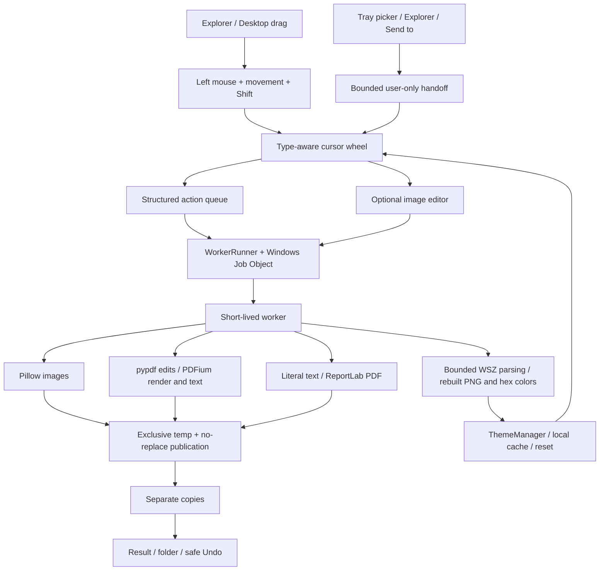

# Architecture

`desktop.py` owns tray lifetime, action queues and results. `trigger.py` polls
mouse, Shift and Escape only. `radial.py` receives file drops, checks families,
and accepts CopyAction. File contents are read only in a worker after selection.
`actions.py` supplies families/actions; `core.py` handles images and delegates to
`documents.py` for PDFs/text. The editor is optional, with worker-generated previews
and source fingerprint matching. It is not the primary application window.

`runner.py` applies limits and bounded child-process IPC. `ipc.py` is a separate,
bounded user-only named pipe for instance handoff. Its messages can open file
menus but cannot choose conversions. `shell.py` registers HKCU entries on explicit
request. Send to uses a native .lnk targeting Python; user file names never pass
through cmd.exe. A constant PowerShell setup script creates that shortcut, taking
path values as environment data instead of interpolating executable source.

Resource limits are not filesystem/network isolation. Normal document errors
roll back job outputs; forced termination can leave outputs or temporary files.
See SECURITY.md and validation.md for tested boundaries.

The Windows build freezes the worker separately, embeds it into one windowless
UI executable, and starts it using QProcess pipes. `runner.py` selects the bundled
worker when frozen; it never asks an end user to install Python. `packaged_check.py`
checks that actual frozen path. See building-windows.md.

`skins.py` parses .wsz only in workers; `palette.py` defines allowed theme roles;
`theming.py` validates and applies the sanitized colors/header and persists a small
cache. The theme stylesheet is generated from known built-in tokens, never skin
source. Both painted cursor actions and Qt controls use the adapted palette.
