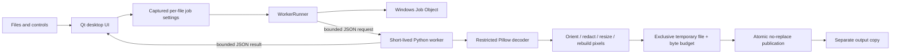

# Architecture

`core.py` contains file budgets, operation validation, transformations and
publication. It has no Qt dependency. `worker.py` waits for one bounded request
before importing the image engine. `runner.py` starts workers, applies Windows
limits before sending requests, and handles IPC, cancellation and deadlines.
`limits.py` owns Job Object handles. `app.py` contains the interface, preview
interaction and queue state.

Inspection uses the same worker boundary as export. Only the resized PNG preview
crosses back into the UI, which decodes it with Qt. Inspection and encoding can
run simultaneously; exports themselves are sequential. Queue settings and boxes
are copied at submission time so later control changes don't mutate pending jobs.

Resource limits contain accidental resource consumption, not filesystem/network
access. The worker is deliberately not described as a sandbox. Forced termination
can leave temporary outputs; normal failure cleans its own temporary file.
