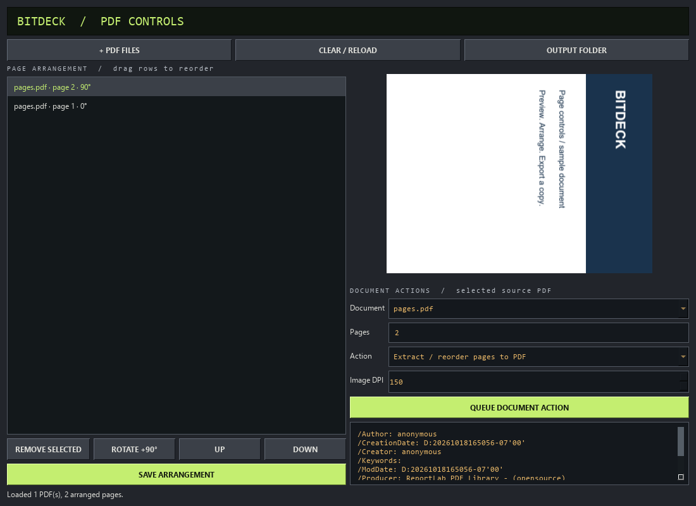

# Local validation — v0.4

18 October 2026. Windows x64, Python 3.10.11. Exact package versions and Windows
wheel hashes are in the runtime/development lock files.

Source regression result: **76 passed, 1 skipped**. The skip is the live
user-restricted named-pipe test below. Theme-specific checks also passed after
light-theme readability fixes. Tests cover archive path traversal, duplicate
assets, file-count limits, color/style injection, PNG dimension limits, worker
skin import, rendering, saved settings, reload and default reset.

The executable passed **18 packaged checks** and exited cleanly. Verification
covers the image/PDF controls as well as the earlier conversion and theme paths,
with Python/developer tools removed
from PATH and Python-related environment variables cleared: image preview/export,
text-to-PDF, PDF raster/text extraction, merge/split, AES-256 protection, classic
.wsz import and Qt theme application/reset. Python and UI/worker dependencies are
bundled; no external interpreter is launched. This was not an OS image with Python
physically uninstalled. Build and verification commands are in building-windows.md.

The processing and integration suite covers images, redaction, orientation,
metadata removal, source-change rejection, publication races, worker lifecycle,
cancellation/deadlines and Windows memory limits, plus PDF raster/text output,
split/merge order, rotation, compression, AES-256 protection, embedded-image
extraction, metadata clearing, literal text-to-PDF, text normalization,
image-to-PDF, document budgets and output rollback.

`scripts/smoke_desktop.py` uses native Qt drop-event objects, not injected mouse
input. It verifies CopyAction, mixed-family rejection, routing to real worker
outputs and the mocked Shift polling state machine. The screenshot captures the
actual cursor menu. This does not prove real Explorer/OLE drag behavior.
The cursor menu shows conversion and editing actions together. Checks verify all
11 PDF targets, all 8 image actions, unchanged actions across the legacy toggle,
and a drop in the release strip followed by a click on Page controls.
`scripts/smoke_ui.py` covers the optional editor and simulated Undo failures.

`scripts/smoke_editing.py` drives the actual image tool controls and workers for
crop/rotation/annotation, then PDF preview, page rotation/reordering/assembly,
range export, and queue pause/cancel/retry with a deliberately failed file followed
by a successful file. It checks that queue requests capture settings independently
of later mutation and treats Qt callback exceptions as failures. Backend tests
check GPS retention/removal, transformed pixels/dimensions, repeated/reversed PDF
pages and independent rotations, encrypted preview/decrypted output, metadata
editing, changed-source rejection and oversized/invalid range expressions.



The sandbox denies QLocalServer's user-restricted named pipe with
`QLocalServerPrivate::addListener: Access is denied.` Payload schema checks are
separate, but live receiver verification is skipped when that happens.
Explorer/Send to registration has not been installed or manually tested here.
Those paths need a normal interactive Windows session. Startup fails clearly
rather than falling back to an unrestricted listener.

Use workspace temporary data in this restricted environment:

```powershell
New-Item -ItemType Directory -Force work | Out-Null
.\.venv\Scripts\python.exe -m pytest -q --basetemp=work/test-data
```

The pip-audit lookup found no known advisories for pinned runtime packages at
review time; see dependency-audit.json. This does not fully audit bundled native
PDFium/Qt libraries or prove absence of flaws. CI is configured for Windows with
pinned actions. Hosted results are shown separately in GitHub Actions; the results
above describe local verification. No signed release or full desktop validation
is claimed. An unsigned portable executable is provided
for local review; its Windows ZIP includes the machine-readable packaged checks.
